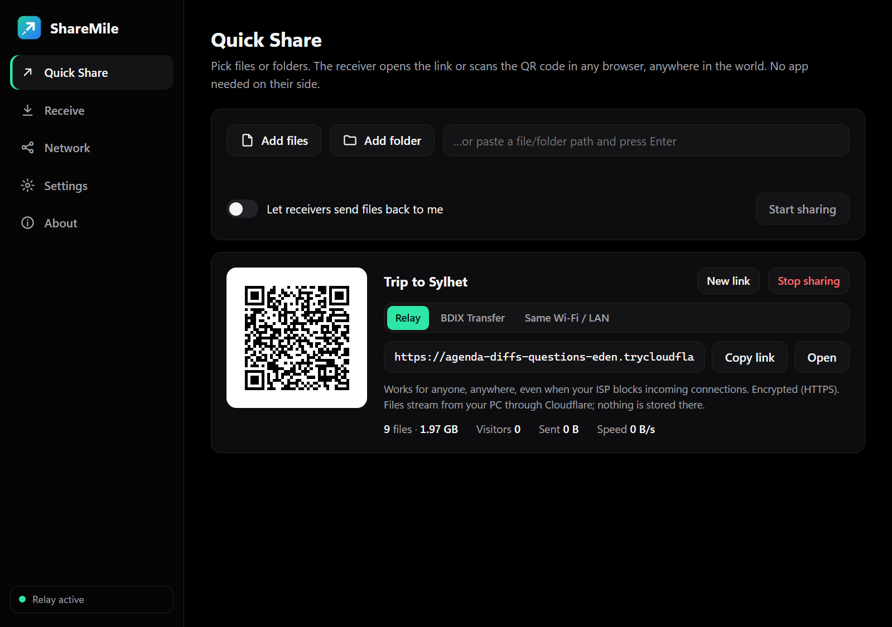
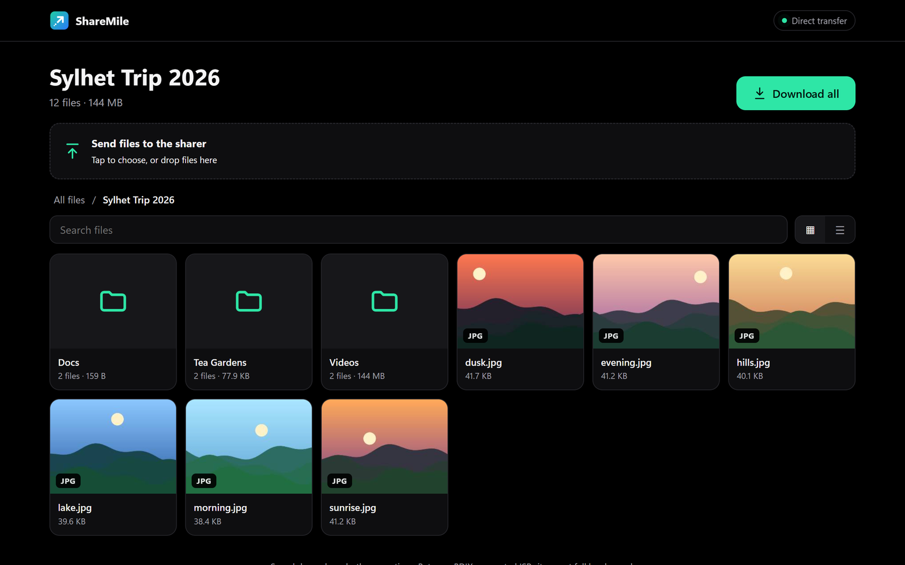
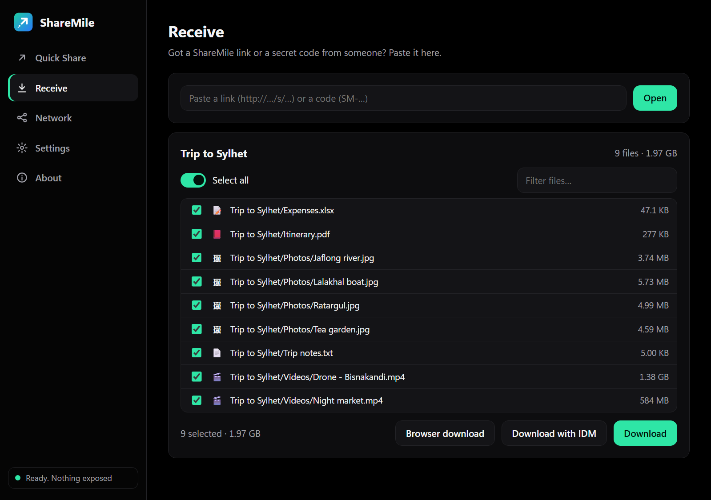
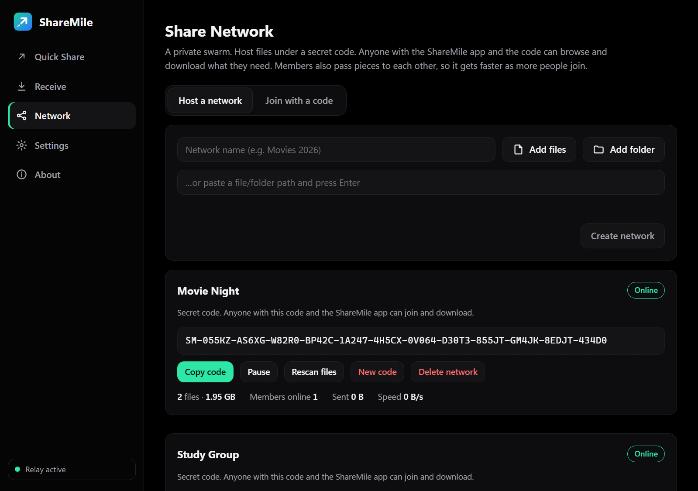
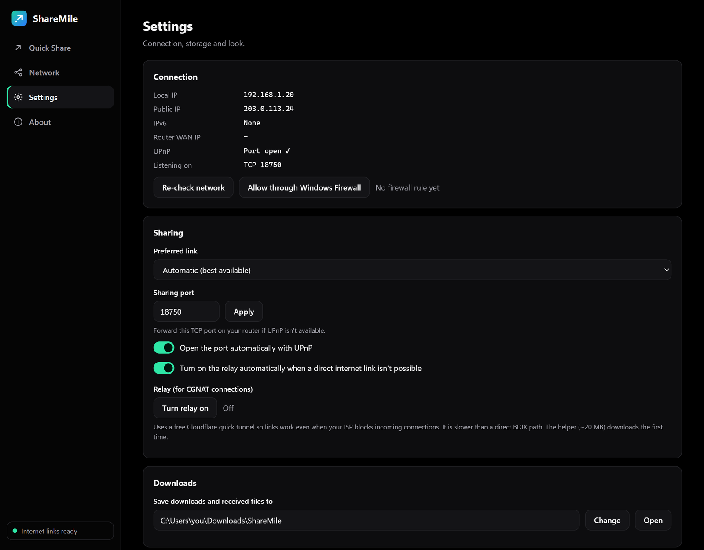
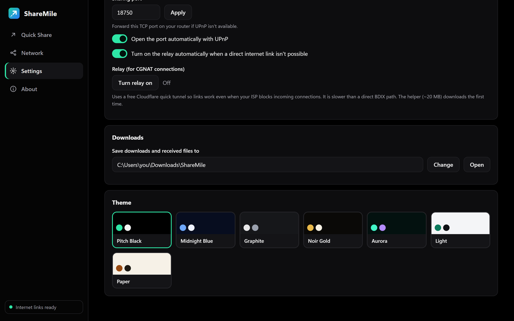
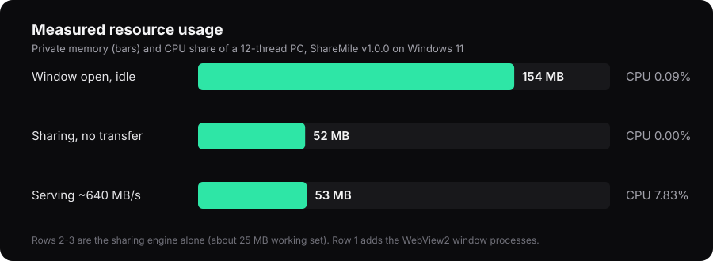
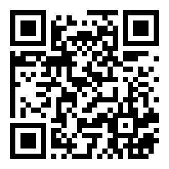

<p align="center">
  
</p>

<p align="center">
  <b>Share any file or folder with anyone, anywhere, straight from your Windows PC.</b><br>
  Receivers just open a link or scan a QR code in their browser. No uploads, no cloud, no account.
</p>

<p align="center">
  <a href="https://github.com/tasin-py/ShareMile/releases/latest"></a>
  <a href="https://github.com/tasin-py/ShareMile/releases"></a>
  <a href="LICENSE"></a>
  
</p>
<p align="center">
  
  
  
  
  <a href="https://github.com/tasin-py/ShareMile/issues"></a>
  <a href="https://github.com/tasin-py/ShareMile/stargazers"></a>
  <a href="https://github.com/tasin-py/ShareMile/network/members"></a>
  
  
</p>

<p align="center">
  <a href="https://github.com/tasin-py/ShareMile/releases/latest/download/ShareMile-Setup.exe"><b>⬇ Download installer</b></a>
  &nbsp;·&nbsp;
  <a href="https://github.com/tasin-py/ShareMile/releases/latest/download/ShareMile.exe"><b>Portable .exe</b></a>
  &nbsp;·&nbsp;
  <a href="https://www.supportkori.com/tasinpy"><b>☕ Buy Me a Coffee</b></a>
</p>

---

<p align="center">
  
</p>

## What it does

ShareMile turns your PC into a tiny, private file server for exactly the files you pick. Nothing is uploaded anywhere first: the receiver downloads straight from your machine, so the only speed limit is the two internet connections. Between BDIX-connected ISPs in Bangladesh that means full local (BDIX) speed. Abroad, you get whatever your connections allow.

It has two modes:

| | **Quick Share** | **Share Network** |
|---|---|---|
| For | Sending files to anyone | A group that shares a library (friends, a class, a team) |
| Receiver needs | Only a browser (phone or PC) | The ShareMile app + the secret code |
| How they get in | Link or QR code | `SM-XXXXX-…` secret code |
| Picks files | Preview, download one, a folder, a selection, or everything as a ZIP | Browse, search, tick what you want |
| Extra | They can send files back to you (optional) | Members re-share pieces with each other, like a swarm, and every piece is hash-checked |

## Features

- **Pick files or folders**, or paste a path. ShareMile scans them and shows the count and size before you start.
- **Link + QR code + copy button** for every share. **Relay** is the default (works on any connection); **BDIX Transfer**, IPv6 and LAN links sit next to it.
- **A browser page that needs no app**: thumbnails, folder browsing, search, image/video/audio/PDF/text preview, per-file download, folder ZIP, "Download all", and multi-select ZIP. It works on phones too.
- **Link previews**: paste a link in Messenger, WhatsApp, Telegram or Discord and it shows a card with the share's name and size.
- **BDIX Transfer check**: one click tests from the internet whether direct links can reach you. It tells you plainly if your ISP hasn't given you a real IP, or exactly what to forward in your router if it has.
- **Full-speed transfers**: no relay in the direct path, big socket buffers, and HTTP range support, so IDM, ADM and browsers can resume and use multiple connections.
- **Works across the internet**:
  - opens your router port automatically with **UPnP**
  - uses **IPv6** when your ISP provides it
  - starts a free **Cloudflare relay** automatically when you share, so links open from any country even without a real IP (CGNAT)
- **Share Network (swarm)**: a private group under a secret code. Downloads pull 4 MB pieces from the host *and* other members in parallel. SHA-256 verification means a member can't send you a corrupt or fake file. Interrupted downloads resume where they stopped.
- **Built-in downloader**: paste a link on **Receive**, tick files, press **Download**. 8 parallel connections per download (like IDM), folders kept, pause/resume, and it picks up where it stopped even after a crash or restart.
- **Download with IDM** (shown when IDM is installed) or **Browser download**, if you prefer.
- **New link / New code**: retire a link or a network code in one click. Anyone holding the old one loses access.
- **Bookmarks**: save your favourite network codes; they stay in the app and connect in one click.
- **Files back to you**: let people drop files back to you from the share page.
- **Live stats**: visitors, bytes sent, live speed.
- **7 themes**: Pitch Black, Midnight Blue, Graphite, Noir Gold, Aurora, Light and Paper. Text stays readable in all of them.
- **One-click updates** from the About page, plus Buy Me a Coffee.
- **Lightweight**: a single ~9 MB executable, about 25 MB of RAM for the sharing engine, and near-zero CPU when idle.

## Install

1. Download **[ShareMile-Setup.exe](https://github.com/tasin-py/ShareMile/releases/latest/download/ShareMile-Setup.exe)** and run it. You can choose the install folder.
2. On the last page, everything is ticked by default (untick what you don't want):
   - Add ShareMile to Desktop
   - Allow ShareMile through Windows Firewall *(needed so people on the internet can reach you)*
   - Open Project's GitHub Page
   - Launch ShareMile
3. To uninstall, use *Settings → Apps → ShareMile → Uninstall*. It removes the app, shortcuts and firewall rule, and asks before deleting your settings.

Prefer no installer? Grab the **[portable ShareMile.exe](https://github.com/tasin-py/ShareMile/releases/latest/download/ShareMile.exe)**. It needs the Microsoft Edge WebView2 Runtime, which Windows 10/11 already include.

## Usage

### Send files to anyone (Quick Share)
1. Open **Quick Share**, then **Add files** / **Add folder** (or paste a path).
2. Press **Start sharing**.
3. Send the link (**Copy link**) or let them scan the QR code. They open it in any browser, preview, and download.
4. Want to cut off the old link? Press **New link**. The old link and QR stop working immediately; send the new one to whoever should still have access.

<p align="center">
  
  
</p>

### Receive files
People without the app just open the link in a browser. With the app it's faster and more reliable:

1. Open **Receive** and paste the link (or a `SM-…` code, which joins that Share Network).
2. ShareMile lists every file with its size. Tick what you want (or use the filter).
3. Press **Download**. Files land in your download folder (*Settings → Downloads*) with their folders intact.
   Or press **Download with IDM** to queue them in Internet Download Manager, or **Browser download**.

Downloads use 8 connections at once and survive anything: pause and resume, a dropped connection, closing the app, even a crash. If the sender's relay link changes (their app restarted), paste their new link and the download continues.

<p align="center">
  
</p>

### Share a library with a group (Share Network)
1. **Network → Host a network**: name it, add files/folders, then **Create network**.
2. Send members the **secret code**.
3. Members open **Network → Join with a code**, paste it, tick files and press **Download selected**.
4. Keep *"Share what I download with other members"* on, and everyone gets faster.
5. **Bookmark** a network with the bookmark icon (next to the code box, or on the network's card). Bookmarks stay in the app even after you leave, with a one-click **Connect**. Click the icon again to remove it.
6. Hosts can press the red **New code** button to replace the secret code. Everyone who had the old code, including members who already joined, loses access until they get the new one; ShareMile warns you before doing it, and old members see *"The host replaced this network's secret code"*.

<p align="center">
  
</p>

### Which link should I send?
| Link | When it works | Speed |
|---|---|---|
| **Relay** *(default)* | Always, on any connection | Depends on Cloudflare, usually tens of Mbit/s |
| **BDIX Transfer** | You have a **real IP** and the port is open (UPnP or a manual forward). Click the tab to test it | Full line speed, BDIX speed inside BD |
| **Internet IPv6** | Both sides have IPv6 | Full line speed |
| **Same Wi-Fi / LAN** | Only on your local network | Fastest |

Clicking **BDIX Transfer** tests your connection from the internet (via [portchecker.io](https://portchecker.io), which only sees your public IP and the port number). It shows **[Real IP Not enabled]** if your ISP shares one IP between customers (CGNAT); then ask your ISP for a real IP (most BD ISPs offer one). If you do have a real IP, it shows exactly which port to forward.

> **Testing it yourself?** Open the link on your phone with **Wi-Fi off** (mobile data). Many routers can't open your own public IP from inside your own network, even when it works for everyone outside.

> **Heads-up:** Relay links change when ShareMile restarts, and BDIX Transfer links contain your public IP, which your ISP may change (ShareMile notices within 10 minutes). Either way the app always shows the current link; just send the new one.

## Screenshots

<details open>
<summary><b>App</b></summary>
<br>
<p align="center">
  
  
  
  
  
  
</p>
</details>

<details>
<summary><b>Receiver preview</b></summary>
<br>
<p align="center"></p>
</details>

## Performance

Measured on a 12-thread Windows 11 PC. The resource test (v1.0.0) pulled a 300 MB file repeatedly over the LAN at about **640 MB/s**.

**Built-in downloader (v1.2.0)**, 600 MB file, sender and receiver on the same PC over its LAN address:

| Path | Speed |
|---|---|
| ShareMile downloader (8 connections) | **~900 MB/s** |
| Single connection (`curl`, for comparison) | ~210–340 MB/s |
| Through the Cloudflare relay | ~9–10 MB/s *(set by Cloudflare's free tunnel, not by ShareMile)* |

Real-world speed is capped by the slower of the two internet connections.

<p align="center">
  
</p>

## How it works (short version)

- A Go backend serves your files over HTTP on one port (default `8750`). Every Quick Share gets a random 96-bit token in its URL, so links can't be guessed.
- The UI is plain HTML in a WebView2 window, talking to the backend over a token-protected `127.0.0.1` connection.
- A network code (`SM-…`) packs a random 80-bit key plus every address your PC can be reached on (LAN, public IPv4, IPv6, relay). Joining needs no central server. On the same LAN, members also find the host by UDP broadcast.
- Swarm downloads split files into 4 MB pieces. Pieces from other members are checked against SHA-256 hashes from the host before they're written.
- The built-in downloader splits files into 4 MB ranges fetched over 8 connections into a sparse `.smpart` file, with a small `.smpart.json` record of finished ranges, so it can resume after anything.
- New relay links are published only once public DNS knows them, and the app falls back to Cloudflare/Google DNS when your ISP's resolver can't find one yet.
- Transfers are plain HTTP (not encrypted) unless they go through the relay (HTTPS). Don't share anything you couldn't stand someone on the same network path seeing.

## Build from source

Requirements: Go 1.27+, [Inno Setup 6](https://jrsoftware.org/isinfo.php) (for the installer).

```powershell
git clone https://github.com/tasin-py/ShareMile
cd ShareMile
.\build.ps1 -Version 1.2.0
```
Output: `dist\ShareMile.exe`, `dist\ShareMile-Setup.exe`, plus a copy in `builds\v1.2.0\`. Each version gets its own folder and older ones are never overwritten.

Run tests: `go test ./...`. To run a second instance for testing: `ShareMile.exe --data C:\temp\profile2 --port 8760`.

## Changelog

```text
v1.2.0 (2026-11-21)
- New: built-in downloader on the Receive page. Paste a link, tick files, press Download. 8 parallel connections, folders kept, pause/resume, and it resumes after a dropped connection, closing the app or a crash. Paste the sender's new link and an interrupted download continues.
- New: "Download with IDM" (when IDM is installed) and "Browser download" buttons.
- New: "New link" button on every share. The old link and QR stop working at once.
- New: red "New code" button for hosted networks, with a warning. Old members lose access and are told the code was replaced; retrying with an old code no longer counts toward the wrong-link block.
- New: bookmarks for Share Network codes (icon next to the code box and on each joined network). Bookmarks stay after you leave and connect in one click.
- Fix: relay links are shown only once they're live in public DNS, and ShareMile falls back to public DNS if your ISP's resolver can't find one yet ("site can't be reached" right after sharing).
- Fix: the BDIX Transfer tab shows "Not checked yet" with a Check now button instead of a stuck "Checking…".
v1.0.5 (2026-11-21)
- Relay is now the default and first link for every share, and starts as soon as you share.
- "Internet (direct)" is now "BDIX Transfer". Clicking it tests from the internet whether direct links reach you: shows [Real IP Not enabled] on CGNAT connections, or a port-forwarding guide if you have a real IP.
- Settings: a short "No Real IP Found" notice replaces the long warnings, plus a Real IP row.
- Link previews: pasted links show the share's name, size and a ShareMile image in Messenger, WhatsApp, Telegram, Discord and more. Preview bots don't count as visitors.
- The receiver page says "Secure relay" instead of "Direct transfer" when opened through the relay.

v1.0.4 (2026-11-21)
- Installer: removed the "Pin to taskbar" and "Pin to Start" options. ShareMile is still listed in the Start menu, and you can pin it yourself with right-click.

v1.0.3 (2026-11-21)
- Fix: detects double NAT (e.g. a mesh router behind the ISP modem). Before, it showed "Internet links ready" while the direct link was actually blocked; now it switches to the relay link automatically and explains how to get direct links.
- New Receive page: paste a link or a secret code in one place.

v1.0.2 (2026-11-21)
- Security: the router port is opened only while something is shared and closed right after (1-hour lease).
- Security: IPs that try many wrong links/codes are blocked for an hour; the bare address reveals nothing.
- The auto relay also stops when nothing is shared.

v1.0.1 (2026-11-21)
- Fix: after a one-click update, ShareMile now reliably restarts by itself.

v1.0.0 (2026-11-21)
- First release.
- Quick Share: link + QR code, browser page with previews, folder/selection/all ZIP downloads, optional uploads back to you.
- Share Network: secret-code private swarm with multi-source, hash-verified, resumable downloads.
- Internet-first links: UPnP port opening, IPv6, CGNAT detection, automatic Cloudflare relay fallback.
- 7 themes, one-click updates, Buy Me a Coffee, installer with taskbar/Start/Desktop/firewall options.
```

## Credits

Made by **[Tasin](https://github.com/tasin-py)**.

Built with [Go](https://go.dev), [Microsoft Edge WebView2](https://developer.microsoft.com/microsoft-edge/webview2/), [go-webview2](https://github.com/jchv/go-webview2), [goupnp](https://github.com/huin/goupnp), [go-qrcode](https://github.com/skip2/go-qrcode), [x/image](https://pkg.go.dev/golang.org/x/image) and [Inno Setup](https://jrsoftware.org/isinfo.php). The optional relay uses [Cloudflare quick tunnels](https://developers.cloudflare.com/cloudflare-one/connections/connect-networks/do-more-with-tunnels/trycloudflare/).

## Buy Me a Coffee

If ShareMile saved you a trip with a pen drive, a coffee keeps it going. ☕

<p>
  <a href="https://www.supportkori.com/tasinpy"></a><br>
  <a href="https://www.supportkori.com/tasinpy"><b>Buy Me a Coffee</b></a>
</p>

## License

[MIT](LICENSE) © 2026 Tasin
