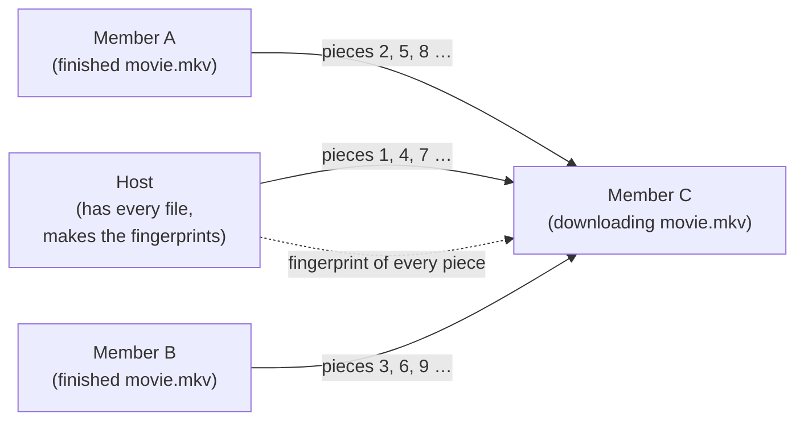
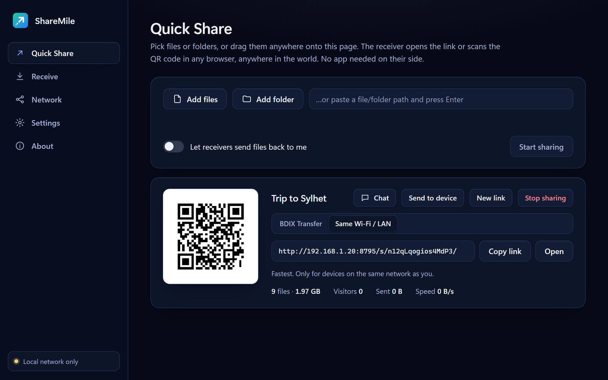

<p align="center">
  
</p>

<p align="center">
  <b>Share any file or folder with anyone, anywhere, straight from your Windows PC.</b><br>
  Receivers just open a link or scan a QR code in their browser. No uploads, no cloud, no account.
</p>

<p align="center">
  <a href="https://github.com/tasin-py/ShareMile/releases/latest"></a>
  <a href="https://github.com/tasin-py/ShareMile/releases"></a>
  <a href="LICENSE"></a>
  
</p>
<p align="center">
  
  
  
  
  <a href="https://github.com/tasin-py/ShareMile/issues"></a>
  <a href="https://github.com/tasin-py/ShareMile/stargazers"></a>
  <a href="https://github.com/tasin-py/ShareMile/network/members"></a>
  
  
</p>

<p align="center">
  <a href="https://github.com/tasin-py/ShareMile/releases/latest/download/ShareMile-Setup.exe"><b>⬇ Download installer</b></a>
  &nbsp;·&nbsp;
  <a href="https://github.com/tasin-py/ShareMile/releases/latest/download/ShareMile-Portable.exe"><b>Portable .exe</b></a>
  &nbsp;·&nbsp;
  <a href="https://www.supportkori.com/tasinpy"><b>☕ Buy Me a Coffee</b></a>
</p>

---

<p align="center">
  
</p>

## What it does

ShareMile turns your PC into a tiny, private file server for exactly the files you pick. Nothing is uploaded to a cloud drive first: the receiver downloads from your machine while you share.

**It works through a relay, on any connection.** Every link goes through a free, encrypted Cloudflare relay by default, so it opens from any country, on any ISP, with no router setup. Most home connections in Bangladesh share one IP between many customers (no "real IP"), and the relay is what makes sharing work there.

**Have a real IP? Then it's BDIX fast.** If your ISP gives you a real (public) IP, ShareMile can also send directly from your PC at full line speed (BDIX speed between Bangladeshi ISPs). This is an optional bonus: one click on **BDIX Transfer** tells you whether your connection supports it.

It has two modes:

| | **Quick Share** | **Share Network** |
|---|---|---|
| For | Sending files to anyone | A group that shares a library (friends, a class, a team) |
| Receiver needs | Only a browser (phone or PC) | The ShareMile app + the secret code |
| How they get in | Link or QR code | `SM-XXXXX-…` secret code |
| Picks files | Preview, download one, a folder, a selection, or everything as a ZIP | Browse, search, tick what you want |
| Extra | They can send files back to you (optional) | A swarm: members who have a file help send it to others, and every piece is hash-checked ([how it works](#how-share-network-works-the-swarm)) |

## How Share Network works (the swarm)

> [!IMPORTANT]
> **The more people have a file, the faster it gets.** In a Share Network the host isn't the only source. Every member who already downloaded a file can send pieces of it to the next member, at the same time as the host. ShareMile checks every piece against a fingerprint made by the host, so a member can never slip you a broken or fake file.



### Step by step

1. **The host is the tracker and the first source.** It keeps the list of files, the list of members who are online, and which member already has which file. No outside server is involved: the secret code carries everything needed to reach the host.
2. **Files are cut into 4 MB pieces.** For each piece the host computes a SHA-256 fingerprint (once, then cached).
3. **When you finish a file, you tell the host you have it,** along with the addresses where you can be reached (your Wi-Fi/LAN address, IPv6, a real IP, or your relay link). This only happens while *"Share what I download with other members"* is ticked on the network's card (it is by default).
4. **When someone starts a download,** ShareMile asks the host who has that file, pings those members, and keeps the ones that answer within 3 seconds.
5. **Pieces are pulled from every source at once.** The host gets 4 parallel connections and each helping member gets 2. They all take the next missing piece from one shared queue, so a fast source simply ends up sending more pieces and a slow one fewer. The download card shows how many sources are helping.
6. **Every piece from a member is checked.** Its SHA-256 must match the host's fingerprint, or it's thrown away and fetched again from another source. A member that keeps failing is dropped, and the host finishes the job. If the fingerprints can't be fetched, ShareMile downloads from the host only.
7. **Progress is saved piece by piece,** so Pause, a dropped connection, closing the app or even a crash only loses the piece that was in flight.

### What this means in practice

- **The host's upload stops being the bottleneck.** With three members already holding a file, the next member can pull from four places at once instead of one.
- **Popular files get faster over time,** because every finished download adds another source.
- **Members on the same Wi-Fi help each other at LAN speed.** If one person in a hall, office or house downloads a file over the internet, the others can take most of it from them across the local network.
- **The host can go easier on its connection,** since members carry part of the load.

### Good to know

- A member helps with a file only **after finishing it**. Two people downloading the same file at the same moment both take it from the host (and from anyone who already has it).
- A member helps only if others **can reach them**: same Wi-Fi/LAN, IPv6, a real IP (BDIX Transfer), or their own relay. Members behind CGNAT with no relay can still download; they just can't serve others over the internet.
- A member serves **only files from that network,** only to people with that network's secret code, and only while ShareMile is running. Untick *"Share what I download with other members"* to download without helping.
- If the host presses **New code**, members with the old code lose access, and that includes being able to fetch pieces from each other.

## Features

- **Pick files or folders, or drag them in**: drop files and folders anywhere on the Quick Share page (or paste a path). ShareMile scans them and shows the count and size before you start.
- **Link + QR code + copy button** for every share. The **Relay** link is the default and works everywhere; Same Wi-Fi, IPv6 and **BDIX Transfer** (real IP only) links sit next to it.
- **A browser page that needs no app**: thumbnails, folder browsing, search, image/video/audio/PDF/text preview, per-file download, folder ZIP, "Download all", and multi-select ZIP. It works on phones too.
- **Link previews**: paste a link in Messenger, WhatsApp, Telegram or Discord and it shows a card with the share's name and size.
- **Works across the internet, out of the box**: a free **Cloudflare relay** starts together with ShareMile, so the link is ready the moment you share, so links open from any country even without a real IP (CGNAT). People on your Wi-Fi get a direct LAN link too.
- **Optional BDIX speed** (real IP only): one click on **BDIX Transfer** tests from the internet whether direct links reach you. It says plainly if your ISP hasn't given you a real IP, or exactly what to forward in your router if it has. UPnP opens the port automatically when your router allows it, and IPv6 is used when your ISP provides it.
- **Resumable transfers**: HTTP range support, so the built-in downloader, IDM, ADM and browsers can resume and use multiple connections.
- **File dates kept**: received files keep the sender's created and modified dates (in-app downloads and Share Network; ZIP downloads keep modified dates).
- **Share Network (swarm)**: a private group under a secret code. Downloads pull 4 MB pieces from the host *and* every member who already has the file, in parallel ([how it works](#how-share-network-works-the-swarm)). SHA-256 verification means a member can't send you a corrupt or fake file. Pause, resume or delete each download, even after a restart.
- **Hosts stay in control**: add or remove folders and single files, rename the network, and choose how members connect (Automatic, Relay, BDIX Transfer, Same Wi-Fi, IPv6). Members see changes within about 30 seconds.
- **Sort file lists** by name, size or date modified.
- **Chat**: talk to the people downloading your Quick Share (from the app or right in their browser, phones included), or use a **group chat** inside a Share Network. **@mentions** with name suggestions, **reply** to a specific message, and **reactions** (👍 ❤️ 😂 😮 😢 🙏 🔥 🎉). Messages stay on the sharer's / host's PC; nothing goes through an outside server. When someone **@mentions you**, a soft chime plays (unless you're already looking at that chat); ordinary messages stay silent.
- **Built-in downloader**: paste a link on **Receive**, tick files, press **Download**. 8 parallel connections per download (like IDM), folders kept, pause/resume, and it picks up where it stopped even after a crash or restart.
- **Download with IDM** (shown when IDM is installed; opens IDM's normal download window for each file) or **Browser download**, if you prefer.
- **New link / New code**: retire a link or a network code in one click. Anyone holding the old one loses access.
- **Bookmarks**: save your favourite network codes; they stay in the app and connect in one click.
- **Paste buttons** next to **Open** and **Join**, so a copied link or code goes in with one click.
- **Your name**: ShareMile asks once on first start. People see **"Connected with …"** your name (and you see theirs) on shares, downloads and networks. Change it any time in *Settings → You*.
- **Runs in the background**: closing the window keeps ShareMile in the notification area (next to the clock), so shares and networks stay online. Right-click the icon for **Open**, **Pause sharing** / **Resume sharing** and **Exit**. Turn it off in *Settings → App*.
- **Pause sharing**: takes every link and network offline and pauses downloads in one click; **Resume** brings them all back.
- **Refresh** on a joined network asks the host to recheck its folders right away; hosts also pick up added, changed or deleted files by themselves.
- **Files back to you**: let people drop files back to you from the share page.
- **Live stats**: visitors, bytes sent, live speed.
- **7 themes**: Pitch Black, Midnight Blue, Graphite, Noir Gold, Aurora, Light and Paper, with refined colours, soft depth and display headings. Text stays readable in all of them.
- **One-click updates** from Settings or the About page, plus Buy Me a Coffee.
- **Lightweight**: a single ~9 MB executable, about 25 MB of RAM for the sharing engine, and near-zero CPU when idle.

## Install

1. Download **[ShareMile-Setup.exe](https://github.com/tasin-py/ShareMile/releases/latest/download/ShareMile-Setup.exe)** and run it. You can choose the install folder.
2. On the last page, everything is ticked by default (untick what you don't want):
   - Add ShareMile to Desktop
   - Allow ShareMile through Windows Firewall *(needed so people on the internet can reach you)*
   - Open Project's GitHub Page
   - Launch ShareMile
3. To uninstall, use *Settings → Apps → ShareMile → Uninstall*. It removes the app, shortcuts and firewall rule, and asks before deleting your settings.

Prefer no installer? Grab **[ShareMile-Portable.exe](https://github.com/tasin-py/ShareMile/releases/latest/download/ShareMile-Portable.exe)**. It needs the Microsoft Edge WebView2 Runtime, which Windows 10/11 already include.

## Usage

### First start
ShareMile asks for your name once. It's shown to the people you share with ("Connected with …") and in chats. Change it in *Settings → You*.

Closing the window doesn't stop sharing: ShareMile keeps running next to the clock. Right-click its icon to **Pause sharing** or **Exit** (or turn this off in *Settings → App*).

### Send files to anyone (Quick Share)
1. Open **Quick Share**, then **Add files** / **Add folder**, drag files and folders onto the page, or paste a path.
2. Press **Start sharing**.
3. Send the link (**Copy link**) or let them scan the QR code. They open it in any browser, preview, and download.
4. Press **Chat** on the share to talk with everyone who has the link. They chat from the browser page (the **Chat** button at the bottom right) or from the app.
5. Want to cut off the old link? Press **New link**. The old link and QR stop working immediately; send the new one to whoever should still have access.

<p align="center">
  
  
</p>

### Receive files
People without the app just open the link in a browser. With the app it's faster and more reliable:

1. Open **Receive** and paste the link (or a `SM-…` code, which joins that Share Network). The **Paste** button fills it in from the clipboard.
2. ShareMile lists every file with its size. Tick what you want (or use the filter).
3. Press **Download**. Files land in your download folder (*Settings → Downloads*) with their folders intact.
   Or press **Download with IDM** (IDM opens its usual download window for each file, so you can start or cancel it there), or **Browser download**.
4. **Chat with sender** opens a chat with the person sharing. The **✕** closes the file list.

Downloads use 8 connections at once and survive anything: pause and resume, a dropped connection, closing the app, even a crash. If the sender's relay link changes (their app restarted), paste their new link and the download continues.

<p align="center">
  
</p>

### Share a library with a group (Share Network)
1. **Network → Host a network**: name it, add files/folders, then **Create network**.
2. Send members the **secret code**.
3. Members open **Network → Join with a code**, paste it, tick files and press **Download selected**. Sort the list by name, size or date modified. The card shows **Connected with** the host's name; **Refresh** fetches the host's latest files right away (changes also arrive by themselves within about a minute).
4. Each download has **Pause / Resume** and a **✕** button. ✕ on an unfinished download deletes its partial file; on a finished one it only clears it from the list (the file stays). Unfinished downloads are still listed after a restart.
5. Keep *"Share what I download with other members"* on, and everyone gets faster.
6. **Group chat** (on the network's card) is a chat room for the host and every member: type `@` to mention someone, hover a message to **reply** or **react**.
7. **Bookmark** a network with the bookmark icon (next to the code box, or on the network's card). Bookmarks stay in the app even after you leave, with a one-click **Connect**. Click the icon again to remove it.
8. Hosts can press the red **New code** button to replace the secret code. Everyone who had the old code, including members who already joined, loses access until they get the new one; ShareMile warns you before doing it, and old members see *"The host replaced this network's secret code"*. The group chat starts fresh with the new code.

**For hosts:**
- **Members connect via** picks how members reach you. **Automatic** (default) puts the relay plus every direct address in the code. **Relay** works anywhere. **BDIX Transfer** needs a real IP. **Same Wi-Fi / LAN only** keeps the network local. After changing it, send the updated code to new members.
- **Edit files** lets you rename the network, add files or folders, remove a whole folder, or remove single files with ✕ (they stay on your PC). **Restore removed** brings them back.

<p align="center">
  
</p>

### Which link should I send?
**Send the Relay link.** It's picked for you, works on every connection, and is all most people ever need.

| Link | When it works | Speed |
|---|---|---|
| **Relay** *(default, recommended)* | Always, on any connection, from any country | Typically ~9–10 MB/s, set by Cloudflare's free tunnel |
| **Same Wi-Fi / LAN** | The receiver is on your Wi-Fi | Fastest |
| **BDIX Transfer** *(bonus)* | Only if your ISP gives you a **real IP** and the port is open (UPnP or a manual forward). Click the tab to test it | Full line speed, BDIX speed inside BD |
| **Internet IPv6** | Both sides have IPv6 | Full line speed |

No real IP? Nothing is missing: the relay covers you. Clicking **BDIX Transfer** tests your connection from the internet (via [portchecker.io](https://portchecker.io), which only sees your public IP and the port number). It shows **[Real IP Not enabled]** if your ISP shares one IP between customers (CGNAT); then ask your ISP for a real IP (most BD ISPs offer one). If you do have a real IP, it shows exactly which port to forward.

> **Testing it yourself?** Open the link on your phone with **Wi-Fi off** (mobile data). Many routers can't open your own public IP from inside your own network, even when it works for everyone outside.

> **Heads-up:** Relay links change when ShareMile restarts, and BDIX Transfer links contain your public IP, which your ISP may change (ShareMile notices within 10 minutes). Either way the app always shows the current link; just send the new one.

## Screenshots

<details open>
<summary><b>App</b></summary>
<br>
<p align="center">
  
  
  
  
  
  
</p>
</details>

<details>
<summary><b>Receiver preview</b></summary>
<br>
<p align="center"></p>
</details>

## Performance

Measured on a 12-thread Windows 11 PC. The resource test (v1.0.0) pulled a 300 MB file repeatedly over the LAN at about **640 MB/s**.

**Built-in downloader (v1.2.0)**, 600 MB file, sender and receiver on the same PC over its LAN address:

| Path | Speed |
|---|---|
| ShareMile downloader (8 connections) | **~900 MB/s** |
| Single connection (`curl`, for comparison) | ~210–340 MB/s |
| Through the Cloudflare relay | ~9–10 MB/s *(set by Cloudflare's free tunnel, not by ShareMile)* |

Real-world speed is capped by the slower of the two internet connections.

<p align="center">
  
</p>

## How it works (short version)

- A Go backend serves your files over HTTP on one port (default `8750`). Every Quick Share gets a random 96-bit token in its URL, so links can't be guessed.
- The UI is plain HTML in a WebView2 window, talking to the backend over a token-protected `127.0.0.1` connection.
- A network code (`SM-…`) packs a random 80-bit key plus every address your PC can be reached on (LAN, public IPv4, IPv6, relay). Joining needs no central server. On the same LAN, members also find the host by UDP broadcast.
- Swarm downloads split files into 4 MB pieces. Pieces from other members are checked against SHA-256 hashes from the host before they're written.
- The built-in downloader splits files into 4 MB ranges fetched over 8 connections into a sparse `.smpart` file, with a small `.smpart.json` record of finished ranges, so it can resume after anything.
- New relay links are published only once public DNS knows them, and the app falls back to Cloudflare/Google DNS when your ISP's resolver can't find one yet.
- Transfers are plain HTTP (not encrypted) unless they go through the relay (HTTPS). Don't share anything you couldn't stand someone on the same network path seeing.

## Build from source

Requirements: Go 1.27+, [Inno Setup 6](https://jrsoftware.org/isinfo.php) (for the installer).

```powershell
git clone https://github.com/tasin-py/ShareMile
cd ShareMile
.\build.ps1 -Version 1.6.1
```
Output: `dist\ShareMile-Portable.exe`, `dist\ShareMile-Setup.exe`, plus a copy in `builds\v1.6.1\`. Each version gets its own folder and older ones are never overwritten.

Run tests: `go test ./...`. To run a second instance for testing: `ShareMile.exe --data C:\temp\profile2 --port 8760`.

## Changelog

```text
v1.6.1 (2026-11-22)
- Changed: the relay starts when ShareMile opens (with Auto relay on), so the relay link is ready the moment you share instead of 10 to 30 seconds later. Turning Auto relay off closes an idle relay; pressing Stop relay keeps it off until you start it again.
- New: a relay that couldn't start (for example, no internet yet at startup) or stopped by itself is retried once a minute.
- README: a detailed section on how Share Network's swarm works.

v1.6.0 (2026-11-22)
- New: a soft chime when someone @mentions you in a chat. It stays quiet when that chat is open in a focused window, and ordinary messages never make a sound.
- New: a more premium look across the whole app. All seven themes have refined colours with their own shadows and highlights; headings use Segoe UI Variable Display; buttons, tabs, toggles, fields and the chat drawer are restyled, with clear focus rings and smoother motion (reduced when Windows asks for less motion).
- Fixed: progress bars animate smoothly without resizing.

v1.5.0 (2026-11-21)
- New: Run in the background (on by default). Closing the window keeps ShareMile in the notification area; right-click its icon for Open, Pause sharing / Resume sharing and Exit. Opening ShareMile again brings the window back.
- New: Pause sharing (tray menu, Settings → App, and a banner with Resume). Links and networks go offline, downloads pause, and Resume restarts exactly those downloads. Members see "The host paused sharing".
- New: ShareMile asks for your name on first start. Shares, downloads and networks show "Connected with <name>" on both sides. Change it in Settings → You.
- New: Refresh button on joined networks: the host rechecks its folders and the latest file list arrives right away.
- New: hosts pick up added, changed or deleted files automatically (members see them within about a minute), and members only re-download the list when it actually changed.
- New: Check for Updates in Settings (also still in About).

v1.4.0 (2026-11-21)
- New: chat. Quick Share has a chat between the sharer and everyone with the link (in the app and on the browser page, phones included); each Share Network has a group chat for the host and members.
- New: @mentions with name suggestions, replies to a specific message, and emoji reactions in chats. Unread badges show new messages.
- New: drag and drop files and folders anywhere on the Quick Share page (and on Network → Host a network).
- New: Paste buttons next to Open (Receive) and Join (Network).
- New: a ✕ button closes the opened file list on the Receive page.
- New: Settings → Chat sets your name in chats.
- Fix: dropping a file on the app window no longer replaces the app's page.

v1.3.0 (2026-11-21)
- New: Pause / Resume for each Share Network download, and a ✕ button that deletes an unfinished download (partial file included) or clears a finished one from the list.
- New: unfinished Share Network downloads are still listed after restarting the app, so they can be resumed or deleted.
- New: sort file lists by name, size or date modified (Share Network and Receive).
- New: "Members connect via" for hosted networks: Automatic, Relay, BDIX Transfer, Same Wi-Fi / LAN only, or IPv6.
- New: hosts can edit a network: rename it, add files or folders, remove folders or single files, and restore removed ones. Members pick up changes within about 30 seconds.
- New: received files keep the sender's created and modified dates.
- Fix: "Download with IDM" opens IDM's normal download window for each file instead of adding them silently to IDM's queue, so cancelling in IDM no longer re-adds the download.
- README: explains that ShareMile works through the relay on any connection, with BDIX speed as a bonus for real-IP users.

v1.2.0 (2026-11-21)
- The portable download is now named ShareMile-Portable.exe (the installed app is still ShareMile.exe).
- New: built-in downloader on the Receive page. Paste a link, tick files, press Download. 8 parallel connections, folders kept, pause/resume, and it resumes after a dropped connection, closing the app or a crash. Paste the sender's new link and an interrupted download continues.
- New: "Download with IDM" (when IDM is installed) and "Browser download" buttons.
- New: "New link" button on every share. The old link and QR stop working at once.
- New: red "New code" button for hosted networks, with a warning. Old members lose access and are told the code was replaced; retrying with an old code no longer counts toward the wrong-link block.
- New: bookmarks for Share Network codes (icon next to the code box and on each joined network). Bookmarks stay after you leave and connect in one click.
- Fix: relay links are shown only once they're live in public DNS, and ShareMile falls back to public DNS if your ISP's resolver can't find one yet ("site can't be reached" right after sharing).
- Fix: the BDIX Transfer tab shows "Not checked yet" with a Check now button instead of a stuck "Checking…".
v1.0.5 (2026-11-21)
- Relay is now the default and first link for every share, and starts as soon as you share.
- "Internet (direct)" is now "BDIX Transfer". Clicking it tests from the internet whether direct links reach you: shows [Real IP Not enabled] on CGNAT connections, or a port-forwarding guide if you have a real IP.
- Settings: a short "No Real IP Found" notice replaces the long warnings, plus a Real IP row.
- Link previews: pasted links show the share's name, size and a ShareMile image in Messenger, WhatsApp, Telegram, Discord and more. Preview bots don't count as visitors.
- The receiver page says "Secure relay" instead of "Direct transfer" when opened through the relay.

v1.0.4 (2026-11-21)
- Installer: removed the "Pin to taskbar" and "Pin to Start" options. ShareMile is still listed in the Start menu, and you can pin it yourself with right-click.

v1.0.3 (2026-11-21)
- Fix: detects double NAT (e.g. a mesh router behind the ISP modem). Before, it showed "Internet links ready" while the direct link was actually blocked; now it switches to the relay link automatically and explains how to get direct links.
- New Receive page: paste a link or a secret code in one place.

v1.0.2 (2026-11-21)
- Security: the router port is opened only while something is shared and closed right after (1-hour lease).
- Security: IPs that try many wrong links/codes are blocked for an hour; the bare address reveals nothing.
- The auto relay also stops when nothing is shared.

v1.0.1 (2026-11-21)
- Fix: after a one-click update, ShareMile now reliably restarts by itself.

v1.0.0 (2026-11-21)
- First release.
- Quick Share: link + QR code, browser page with previews, folder/selection/all ZIP downloads, optional uploads back to you.
- Share Network: secret-code private swarm with multi-source, hash-verified, resumable downloads.
- Internet-first links: UPnP port opening, IPv6, CGNAT detection, automatic Cloudflare relay fallback.
- 7 themes, one-click updates, Buy Me a Coffee, installer with taskbar/Start/Desktop/firewall options.
```

## Credits

Made by **[Tasin](https://github.com/tasin-py)**.

Built with [Go](https://go.dev), [Microsoft Edge WebView2](https://developer.microsoft.com/microsoft-edge/webview2/), [go-webview2](https://github.com/jchv/go-webview2), [goupnp](https://github.com/huin/goupnp), [go-qrcode](https://github.com/skip2/go-qrcode), [x/image](https://pkg.go.dev/golang.org/x/image) and [Inno Setup](https://jrsoftware.org/isinfo.php). The optional relay uses [Cloudflare quick tunnels](https://developers.cloudflare.com/cloudflare-one/connections/connect-networks/do-more-with-tunnels/trycloudflare/).

## Buy Me a Coffee

If ShareMile saved you a trip with a pen drive, a coffee keeps it going. ☕

<p>
  <a href="https://www.supportkori.com/tasinpy"></a><br>
  <a href="https://www.supportkori.com/tasinpy"><b>Buy Me a Coffee</b></a>
</p>

## License

[MIT](LICENSE) © 2026 Tasin
