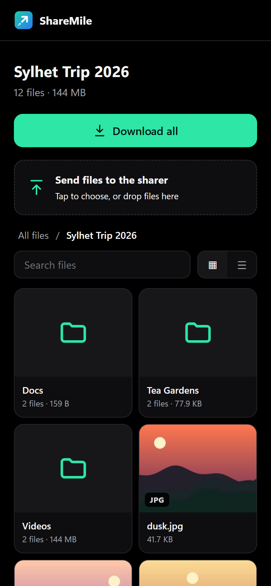
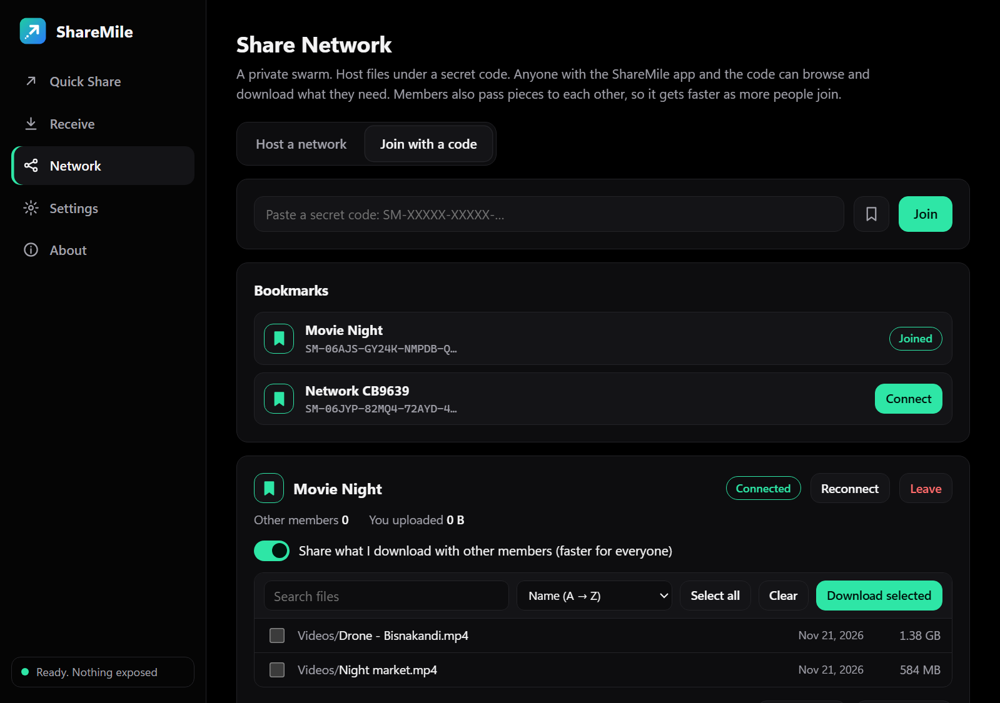
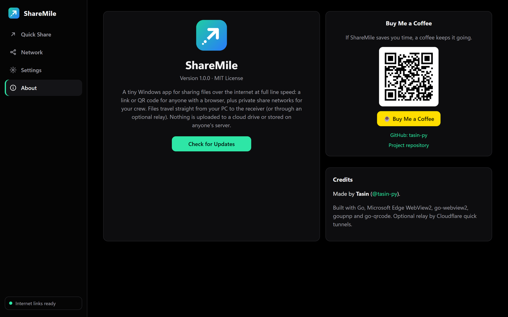
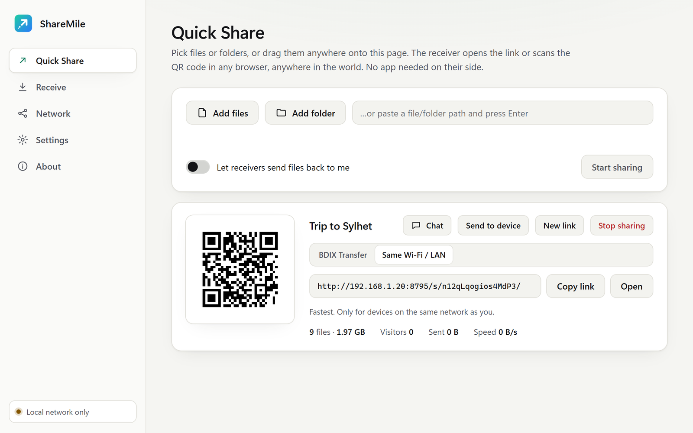
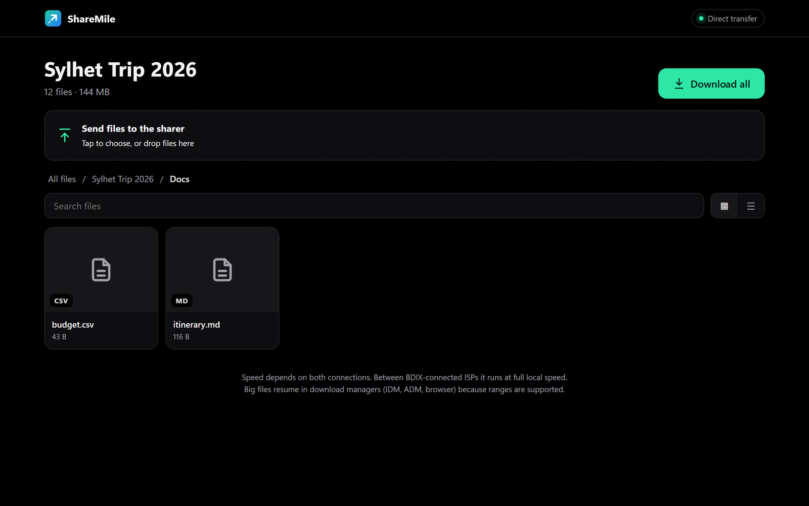

<p align="center">
  
</p>

<p align="center">
  <b>Share any file or folder with anyone, anywhere, straight from your Windows PC.</b><br>
  Receivers just open a link or scan a QR code in their browser. No uploads, no cloud, no account.
</p>

<p align="center">
  <a href="https://github.com/tasin-py/ShareMile/releases/latest"></a>
  <a href="https://github.com/tasin-py/ShareMile/releases"></a>
  <a href="LICENSE"></a>
  
</p>
<p align="center">
  
  
  
  
  <a href="https://github.com/tasin-py/ShareMile/issues"></a>
  <a href="https://github.com/tasin-py/ShareMile/stargazers"></a>
  <a href="https://github.com/tasin-py/ShareMile/network/members"></a>
  
  
</p>

<p align="center">
  <a href="https://github.com/tasin-py/ShareMile/releases/latest/download/ShareMile-Setup.exe"><b>⬇ Download installer</b></a>
  &nbsp;·&nbsp;
  <a href="https://github.com/tasin-py/ShareMile/releases/latest/download/ShareMile.exe"><b>Portable .exe</b></a>
  &nbsp;·&nbsp;
  <a href="https://www.supportkori.com/tasinpy"><b>☕ Buy Me a Coffee</b></a>
</p>

---

<p align="center">
  
</p>

## What it does

ShareMile turns your PC into a tiny, private file server for exactly the files you pick. Nothing is uploaded anywhere first: the receiver downloads straight from your machine, so the only speed limit is the two internet connections. Between BDIX-connected ISPs in Bangladesh that means full local (BDIX) speed. Abroad, you get whatever your connections allow.

It has two modes:

| | **Quick Share** | **Share Network** |
|---|---|---|
| For | Sending files to anyone | A group that shares a library (friends, a class, a team) |
| Receiver needs | Only a browser (phone or PC) | The ShareMile app + the secret code |
| How they get in | Link or QR code | `SM-XXXXX-…` secret code |
| Picks files | Preview, download one, a folder, a selection, or everything as a ZIP | Browse, search, tick what you want |
| Extra | They can send files back to you (optional) | Members re-share pieces with each other, like a swarm, and every piece is hash-checked |

## Features

- **Pick files or folders**, or paste a path. ShareMile scans them and shows the count and size before you start.
- **Link + QR code + copy button** for every share. Choose between Internet, IPv6, LAN or Relay links.
- **A browser page that needs no app**: thumbnails, folder browsing, search, image/video/audio/PDF/text preview, per-file download, folder ZIP, "Download all", and multi-select ZIP. It works on phones too.
- **Full-speed transfers**: no relay in the direct path, big socket buffers, and HTTP range support, so IDM, ADM and browsers can resume and use multiple connections.
- **Works across the internet**:
  - opens your router port automatically with **UPnP**
  - uses **IPv6** when your ISP provides it
  - detects **CGNAT** and **double NAT** (a mesh router behind the ISP modem) and, if a direct link can't work, turns on a free **Cloudflare relay** automatically so links still open from any country
- **Share Network (swarm)**: a private group under a secret code. Downloads pull 4 MB pieces from the host *and* other members in parallel. SHA-256 verification means a member can't send you a corrupt or fake file. Interrupted downloads resume where they stopped.
- **Receive page**: paste any ShareMile link or secret code and it opens or joins for you.
- **Files back to you**: let people drop files back to you from the share page.
- **Live stats**: visitors, bytes sent, live speed.
- **7 themes**: Pitch Black, Midnight Blue, Graphite, Noir Gold, Aurora, Light and Paper. Text stays readable in all of them.
- **One-click updates** from the About page, plus Buy Me a Coffee.
- **Lightweight**: a single ~9 MB executable, about 25 MB of RAM for the sharing engine, and near-zero CPU when idle.

## Install

1. Download **[ShareMile-Setup.exe](https://github.com/tasin-py/ShareMile/releases/latest/download/ShareMile-Setup.exe)** and run it. You can choose the install folder.
2. On the last page, everything is ticked by default (untick what you don't want):
   - Pin ShareMile to taskbar
   - Pin ShareMile to Start
   - Add ShareMile to Desktop
   - Allow ShareMile through Windows Firewall *(needed so people on the internet can reach you)*
   - Open Project's GitHub Page
   - Launch ShareMile
3. To uninstall, use *Settings → Apps → ShareMile → Uninstall*. It removes the app, shortcuts and firewall rule, and asks before deleting your settings.

Prefer no installer? Grab the **[portable ShareMile.exe](https://github.com/tasin-py/ShareMile/releases/latest/download/ShareMile.exe)**. It needs the Microsoft Edge WebView2 Runtime, which Windows 10/11 already include.

## Usage

### Send files to anyone (Quick Share)
1. Open **Quick Share**, then **Add files** / **Add folder** (or paste a path).
2. Press **Start sharing**.
3. Send the link (**Copy link**) or let them scan the QR code. They open it in any browser, preview, and download.

<p align="center">
  
  
</p>

### Receive files
Open **Receive** in the app and paste what you were sent. A link opens in your browser (no app needed for that; phones work too). A secret code (`SM-…`) joins that Share Network.

### Share a library with a group (Share Network)
1. **Network → Host a network**: name it, add files/folders, then **Create network**.
2. Send members the **secret code**.
3. Members open **Network → Join with a code**, paste it, tick files and press **Download selected**.
4. Keep *"Share what I download with other members"* on, and everyone gets faster.

<p align="center">
  
</p>

### Which link should I send?
| Link | When it works | Speed |
|---|---|---|
| **Internet (direct)** | The receiver is anywhere and your router port is open (UPnP did it, or you forwarded it) | Full line speed, BDIX speed inside BD |
| **Internet IPv6** | Both sides have IPv6 | Full line speed |
| **Same Wi-Fi / LAN** | Only on your local network | Fastest |
| **Relay** | Always, even behind CGNAT or double NAT | Depends on Cloudflare, usually tens of Mbit/s |

*Automatic* (the default) picks the best one for you. If your ISP gives you a CGNAT address, ask them for a real public IP (most BD ISPs offer one) to get direct BDIX-speed links.

> **Testing it yourself?** Open the link on your phone with **Wi-Fi off** (mobile data). Many routers can't open your own public IP from inside your own network, even when it works for everyone outside.

> **Heads-up:** links contain your current public IP. If your ISP changes it, ShareMile notices within 10 minutes and shows the new link. Old links stop working, so just send the new one.

## Screenshots

<details open>
<summary><b>App</b></summary>
<br>
<p align="center">
  
  
  
  
  
  
</p>
</details>

<details>
<summary><b>Receiver preview</b></summary>
<br>
<p align="center"></p>
</details>

## Performance

Measured on a 12-thread Windows 11 PC with v1.0.0. The download test pulled a 300 MB file repeatedly over the LAN at about **640 MB/s**.

<p align="center">
  
</p>

## How it works (short version)

- A Go backend serves your files over HTTP on one port (default `8750`). Every Quick Share gets a random 96-bit token in its URL, so links can't be guessed.
- The UI is plain HTML in a WebView2 window, talking to the backend over a token-protected `127.0.0.1` connection.
- A network code (`SM-…`) packs a random 80-bit key plus every address your PC can be reached on (LAN, public IPv4, IPv6, relay). Joining needs no central server. On the same LAN, members also find the host by UDP broadcast.
- Swarm downloads split files into 4 MB pieces. Pieces from other members are checked against SHA-256 hashes from the host before they're written.
- Transfers are plain HTTP (not encrypted) unless they go through the relay (HTTPS). Don't share anything you couldn't stand someone on the same network path seeing.

## Build from source

Requirements: Go 1.27+, [Inno Setup 6](https://jrsoftware.org/isinfo.php) (for the installer).

```powershell
git clone https://github.com/tasin-py/ShareMile
cd ShareMile
.\build.ps1 -Version 1.0.3
```
Output: `dist\ShareMile.exe`, `dist\ShareMile-Setup.exe`, plus a copy in `builds\v1.0.3\`. Each version gets its own folder and older ones are never overwritten.

Run tests: `go test ./...`. To run a second instance for testing: `ShareMile.exe --data C:\temp\profile2 --port 8760`.

## Changelog

```text
v1.0.3 (2026-11-21)
- Fix: detects double NAT (e.g. a mesh router behind the ISP modem). Before, it showed "Internet links ready" while the direct link was actually blocked; now it switches to the relay link automatically and explains how to get direct links.
- New Receive page: paste a link or a secret code in one place.

v1.0.2 (2026-11-21)
- Security: the router port is opened only while something is shared and closed right after (1-hour lease).
- Security: IPs that try many wrong links/codes are blocked for an hour; the bare address reveals nothing.
- The auto relay also stops when nothing is shared.

v1.0.1 (2026-11-21)
- Fix: after a one-click update, ShareMile now reliably restarts by itself.

v1.0.0 (2026-11-21)
- First release.
- Quick Share: link + QR code, browser page with previews, folder/selection/all ZIP downloads, optional uploads back to you.
- Share Network: secret-code private swarm with multi-source, hash-verified, resumable downloads.
- Internet-first links: UPnP port opening, IPv6, CGNAT detection, automatic Cloudflare relay fallback.
- 7 themes, one-click updates, Buy Me a Coffee, installer with taskbar/Start/Desktop/firewall options.
```

## Credits

Made by **[Tasin](https://github.com/tasin-py)**.

Built with [Go](https://go.dev), [Microsoft Edge WebView2](https://developer.microsoft.com/microsoft-edge/webview2/), [go-webview2](https://github.com/jchv/go-webview2), [goupnp](https://github.com/huin/goupnp), [go-qrcode](https://github.com/skip2/go-qrcode), [x/image](https://pkg.go.dev/golang.org/x/image) and [Inno Setup](https://jrsoftware.org/isinfo.php). The optional relay uses [Cloudflare quick tunnels](https://developers.cloudflare.com/cloudflare-one/connections/connect-networks/do-more-with-tunnels/trycloudflare/).

## Buy Me a Coffee

If ShareMile saved you a trip with a pen drive, a coffee keeps it going. ☕

<p>
  <a href="https://www.supportkori.com/tasinpy"></a><br>
  <a href="https://www.supportkori.com/tasinpy"><b>Buy Me a Coffee</b></a>
</p>

## License

[MIT](LICENSE) © 2026 Tasin
